# ML-RF-Volatility-vs-Returns

A cross-sectional Random Forest trained on **18 years of real Russell 3000 daily bars**
(2007-01-03 → 2024-12-31, 4,530 trading days, 2,661 tickers) — run **twice**, with the same
features, the same hyperparameters, the same walk-forward folds, and only the target swapped.

| | Task A | Task B |
|---|---|---|
| `y` | cross-sectional rank of **next-month return** | cross-sectional rank of **next-month realized volatility** |
| Features | the same 20 | the same 20 |
| Model | `RandomForestRegressor(n_estimators=300, max_depth=12, min_samples_leaf=200, max_features="sqrt")` | identical |
| Pooled OOS R² | **−0.0002** | **+0.6143** |
| Mean monthly IC | **+0.0158** | **+0.7772** |
| IC t-stat | +2.0 | +156.9 |
| Months with IC > 0 | 52% | **100%** (143/143) |

> The point of this project is not the 0.78 IC. It is that **the two numbers above came out of the
> same model.** When a model fails on real data, the interesting question is whether the model is
> too weak or whether the target carries no signal — and the only way to answer it is to hold
> everything else fixed and change the target.

This is the companion piece to
[ML-CNN-Imagenette-Classifier](https://github.com/lukerspace/ML-CNN-Imagenette-Classifier),
which ends on the same shape of conclusion: there, 99.87% of the parameters sit in the first
`Linear` after `Flatten`, so fancier convolutions cannot help. Here, the ceiling is in `y`, so a
fancier model cannot help. **Attributing failure to the right place matters more than fixing it —
because some failures cannot be fixed.**

It is also the control experiment for **what this repository used to contain**. Before this
commit, `Decision-Tree-Factor-Regression` lived here: a decision tree on a *synthetic* factor panel,
reporting Sharpe 27.8, 36 consecutive months without a loss and OOS R² 0.67. Those numbers were
real — they just only proved that a tree can recover structure it planted itself. Part 1 of this
notebook reproduces that exact setup on purpose (R² 0.81 against a computable 0.88 ceiling) to
establish that the pipeline works, and then runs the identical pipeline on real returns. The old
code and its history are still in this repo's git log (`git log -- desision_model.py`).

---

## Results at a glance

| Metric | Task A: next-month return | Task B: next-month volatility |
|---|---:|---:|
| Pooled OOS R² (143 months, 289,030 stock-months) | −0.0002 | **+0.6143** |
| Mean monthly cross-sectional Spearman IC | +0.0158 | **+0.7772** |
| IC t-stat | +2.0 | +156.9 |
| IC standard deviation across months | 0.094 | 0.059 |
| Months with positive IC | 52% | 100% |
| Best single-feature baseline | +0.0170 (`−ret_1m`) | +0.7208 (`parkinson_21d`) |
| Decile long-short Sharpe, net of 10bp | **−0.81** | n/a |
| Permutation importance, sum of positives over 20 features | 0.0029 (12 of 20 negative) | 0.2012 (0 negative) |
| OOB R² / test R² (2024 fold) | 0.0043 / 0.0005 | 0.6183 / 0.6531 |

Runtime: 24 Random Forest fits (12 folds × 2 tasks) over 82k → 342k rows × 20 features. In the
recorded run the fits took 2,141s and the whole notebook 43 minutes on an 8-core Apple Silicon
machine; the last two folds alone accounted for 1,109s of that because the machine was busy with
other work at the time (the first ten folds averaged 44s). On an idle machine, expect ~20 minutes
for the fits and ~25 for the notebook.

---

## Data

```python
import sys; sys.path.insert(0, "/Users/hsieh/Desktop/KICKs")
from aws_fetch_price_data.fetch_fmp_price.price import load_us_price_data
px = load_us_price_data(history="long")      # 2007-01-03 ~ 2024-12-31
```

The notebook goes through the centralized loader and **never hard-codes the parquet path** — that
file is the single source of truth for US price data on this machine and `price.py` forbids
hard-coding it. The parquet itself (305MB) is not in this repo.

| | |
|---|---|
| Shape | 4,530 trading days × 2,661 tickers, MultiIndex columns `(Price, Ticker)` with OHLCV |
| Coverage | 1,415 tickers with prices in 2007, 2,602 in 2024 |
| Cleaned panel | **372,623 stock-months, 201 months, 2008-03 → 2024-11** |

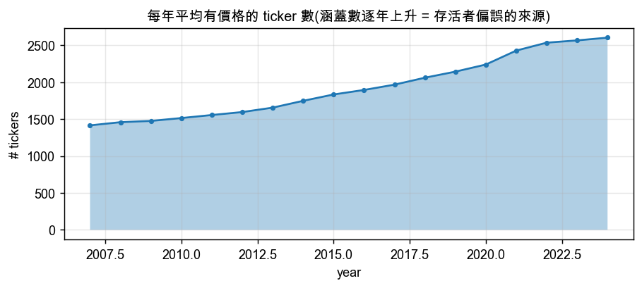

The panel starts in 2008-03 rather than 2007-01 because `ret_12_1` needs 13 months of history and
`vol_252d` / `beta_252d` need 252 trading days. The first year is consumed by the feature windows —
which is also why the walk-forward below yields 12 test years, not 13.

### Survivorship bias — stated up front

This universe is **today's Russell 3000 backfilled to 2007**. Companies that were delisted, went
bankrupt or were acquired between 2008 and 2024 are not in it. The effect is asymmetric:

- **Large for Task A.** The companies that disappear are mostly the ones that fell hardest. Without
  them the left tail of the cross-section is truncated, which makes momentum- and reversal-type
  signals look *better* than they really were. Task A's results below are therefore the
  **optimistic** version — and even the optimistic version produces nothing.
- **Small for Task B.** Volatility persistence is a statistical property of each stock's own return
  series, not a ranking of cross-sectional winners and losers. Losing delisted names thins out the
  high-volatility end but cannot flip "high vol this month → high vol next month".

Fixing this needs a point-in-time index-membership table, which this parquet does not contain. So
the bias is labelled, and it only ever points in the direction that works against the conclusion.

### The premise, measured before any model is trained

| Relationship | IC | t |
|---|---:|---:|
| This month's realized vol → next month's realized vol | **+0.673** | **+132.6** |
| This month's return → next month's return | −0.016 | −1.9 |
| 12-month momentum → next month's return | +0.005 | +0.5 |

Monthly cross-sectional Spearman, 201 months. Volatility is two orders of magnitude more
predictable than return. Every result in this project is downstream of this one table.

---

## The 20 features

OHLCV only — no fundamentals, no analyst data. All settled at month end, all backward-looking.

| Group | Features |
|---|---|
| Return | `ret_1m` `ret_3m` `ret_6m` `ret_12m` `ret_12_1` (momentum skipping the latest month) |
| Risk | `vol_21d` `vol_63d` `vol_252d` `downside_vol_63d` `skew_63d` `kurt_63d` |
| Range | `parkinson_21d` (high–low estimator) `dist_52w_high` `dist_52w_low` `max_dd_252d` |
| Liquidity | `dollar_vol_21d` `volume_trend` `amihud_illiq_21d` |
| Market | `beta_252d` `idio_vol_252d` (both vs. the equal-weight market) |

Features are **cross-sectionally z-scored month by month** (clipped at ±5) so that the 2008 and 2017
absolute levels do not get mixed into one training set. Both targets are **cross-sectionally
rank-normalized to (0,1]**, which is what makes R² and IC comparable across the two tasks: raw
`fwd_ret` has a standard deviation of ~0.12 and raw `fwd_vol` ~0.25, and after rank-normalization
"always predict 0.5" scores exactly R² = 0 in both.

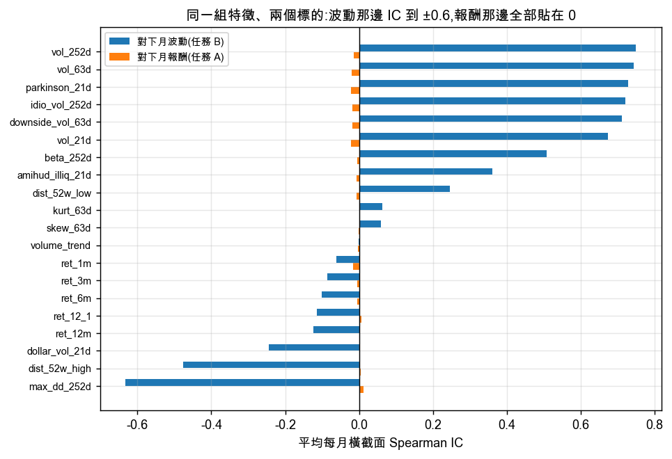

The same 20 features reach |IC| ≈ 0.6 against volatility and sit on zero against return.

---

## Part 1 — verifying the mechanism on synthetic data

Before touching real prices: a panel with a **known** structure (hard-coded factor weights, three
nonlinear terms, Gaussian noise), lifted straight from this repository's predecessor
(`generate_pseudo_factor_panel` in the old `desision_model.py`, still in the git history).
Because the noise is injected on purpose, the R² ceiling is computable:
`Var(signal) / (Var(signal) + σ²) = 0.4436 / (0.4436 + 0.0625) = 0.877`.

| Check | Result |
|---|---|
| RF 300 trees, OOS R² | **0.807** against a 0.877 ceiling |
| Single tree (all features, no bootstrap) | 0.730 |
| RF with 1 tree (`sqrt` features + bootstrap) | 0.644 |
| sd of predictions across 5 seeds | 0.2323 (1 tree) → 0.0130 (300 trees), a 17.9× reduction vs. √300 = 17.3 |
| Spearman(permutation importance, \|true weight\|) | **1.000** — the ordering is recovered exactly |

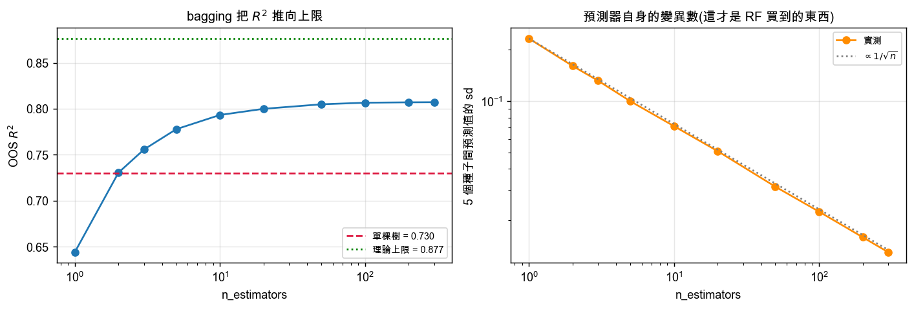
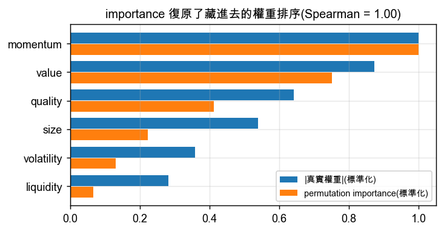

Bagging buys a reduction in the **variance of the estimator**, not in bias — the right panel shows
it decaying as 1/√n, which is the entire difference between a Random Forest and a Decision Tree.

### The noise sweep — a trailer for Part 3

Hold the structure fixed, move σ from 0.1 to 5.0, refit the identical model:

| σ | 0.1 | 0.25 | 0.5 | 1.0 | 2.0 | 3.0 | 4.0 | 5.0 |
|---|---:|---:|---:|---:|---:|---:|---:|---:|
| SNR | 44.4 | 7.10 | 1.77 | 0.44 | 0.11 | 0.049 | 0.028 | 0.018 |
| OOS R² | 0.902 | 0.807 | 0.584 | 0.268 | 0.075 | 0.028 | 0.010 | **0.004** |

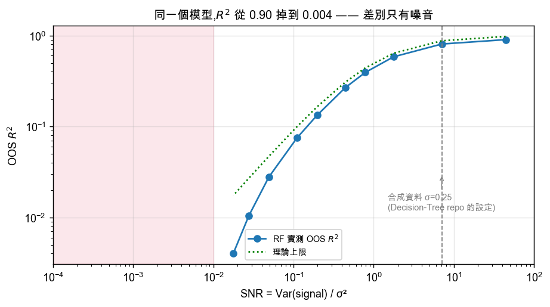

**The same model spans R² from 0.90 to 0.004, and the only thing that changed is the noise.** Real
monthly cross-sectional stock returns sit even further right than σ = 5.0: the strongest known
signals have monthly IC of order 0.0x, and R² ≈ IC², so 10⁻⁴ – 10⁻³.

This is what makes Part 3 interpretable. "The model is broken" has already been ruled out.

---

## Part 3 — walk-forward, the core comparison

- Expanding window, test one calendar year at a time, **test years 2013–2024 → 12 folds**
  (82,065 → 341,997 training rows). Not 13: the panel only starts in 2008-03, so making 2012 a test
  year would leave 3.7 years of training and break the ≥5-year rule first.
- **One-month embargo**: for test year *Y*, training stops at the *Y−1* November feature row. The
  dropped *Y−1* December row has its target inside January of *Y* and would overlap the test window.
- `min_samples_leaf=200`: with IC of order 0.01, small leaves memorize noise.

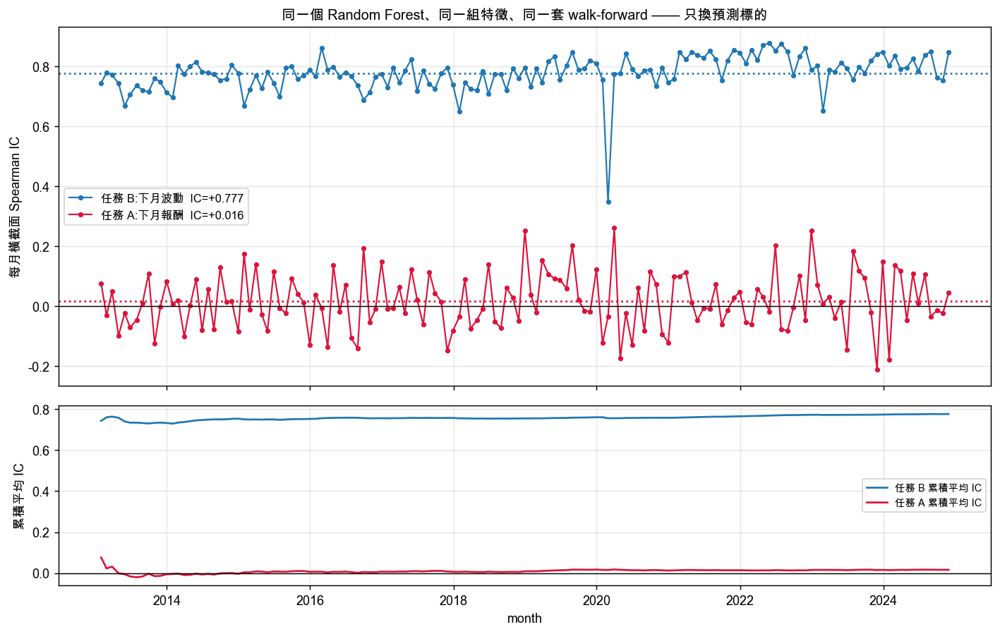

| Pooled over 143 OOS months | Task A | Task B |
|---|---:|---:|
| OOS R² | −0.0002 | +0.6143 |
| Mean IC | +0.0158 | +0.7772 |
| IC t | +2.0 | +156.9 |
| Months IC > 0 | 52% | 100% |

Per fold:

| Test year | A: R² | A: IC | B: R² | B: IC |
|---|---:|---:|---:|---:|
| 2013 | −0.0035 | −0.0059 | 0.5428 | 0.7332 |
| 2014 | −0.0006 | −0.0009 | 0.6009 | 0.7758 |
| 2015 | +0.0017 | +0.0244 | 0.5735 | 0.7511 |
| 2016 | −0.0014 | +0.0097 | 0.5937 | 0.7666 |
| 2017 | −0.0009 | +0.0040 | 0.5869 | 0.7631 |
| 2018 | +0.0002 | +0.0190 | 0.5639 | 0.7453 |
| 2019 | +0.0046 | +0.0690 | 0.6340 | 0.7941 |
| 2020 | −0.0054 | −0.0227 | 0.5515 | 0.7417 |
| 2021 | +0.0004 | +0.0277 | 0.6794 | 0.8237 |
| 2022 | +0.0014 | +0.0251 | 0.7053 | 0.8379 |
| 2023 | −0.0000 | +0.0207 | 0.6259 | 0.7888 |
| 2024 | +0.0005 | +0.0203 | 0.6531 | 0.8071 |

Task B does not have a single losing fold in 12 years, including 2020. Task A changes sign four times.

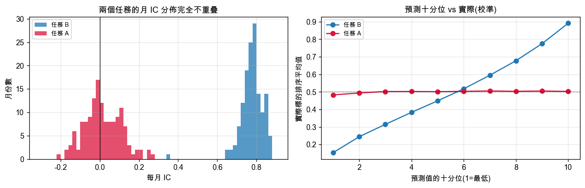

### Does the model beat doing nothing?

A 0.78 IC invites an uncomfortable question: is that the model, or is it just volatility's own
autocorrelation? One number — this month's realized vol — already scores 0.66.

| Task | Predictor | IC | t |
|---|---|---:|---:|
| B | **RF, 20 features** | **+0.7772** | +156.9 |
| B | `parkinson_21d` (best single feature) | +0.7208 | +128.6 |
| B | `cur_vol_m` (this month's realized vol) | +0.6610 | +106.2 |
| B | `vol_21d` | +0.6613 | +106.6 |
| A | **RF, 20 features** | +0.0158 | +2.0 |
| A | `ret_12_1` (momentum) | +0.0102 | +0.9 |
| A | `−ret_1m` (reversal) | +0.0170 | +1.8 |

So the Random Forest **does** add something real on Task B: **+0.116 of IC over the persistence
baseline (t = +29.9 on the monthly differences, positive in 100% of months)**, and +0.056 over the
strongest single feature, `parkinson_21d`. It blends volatility estimates from different windows
(21d / 63d / 252d / Parkinson / downside) instead of trusting one. But note the shape of that gain:
one line of code already gets you 0.66 of the 0.78. On Task A it adds nothing that
survives Part 4 — its +0.0158 is just the reversal baseline's +0.0170 with extra steps.

---

## Part 4 — taking Task A seriously as a strategy

Decile long-short, equal weight, **10bp one-way cost charged on realized turnover**, two universes.

| Universe | Signal | Gross Sharpe | Net Sharpe | Net t | Monthly turnover |
|---|---|---:|---:|---:|---:|
| All | **RF predicted return** | −0.65 | **−0.81** | −2.80 | 2.23 |
| All | 12-1 momentum | −0.08 | −0.14 | −0.48 | 1.00 |
| All | reversal (−`ret_1m`) | +0.37 | +0.13 | +0.45 | 3.37 |
| Top 1000 by dollar volume | RF predicted return | −0.34 | −0.49 | −1.70 | 2.48 |
| Top 1000 by dollar volume | 12-1 momentum | +0.39 | +0.32 | +1.11 | 1.20 |
| Top 1000 by dollar volume | reversal (−`ret_1m`) | +0.04 | −0.18 | −0.64 | 3.46 |

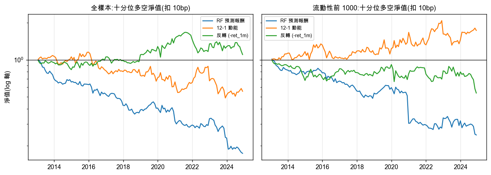

**In the tradable universe, all three signals fail to reject zero.** But the RF column is worse than
that: its decile spread is *negative*, with t = −2.8 net, while its rank IC is *positive*. Both are
true at once, and the decile profile shows why:

| Predicted decile (0 = worst) | Realized annualized return | Median `vol_21d` | Median price | Mean previous-month return |
|---|---:|---:|---:|---:|
| 0 | **+26.1%** | 0.482 | \$18.7 | **+5.5%** |
| 4 | +14.0% | 0.304 | \$36.3 | +1.1% |
| 9 | +15.4% | 0.270 | \$24.0 | **−5.7%** |

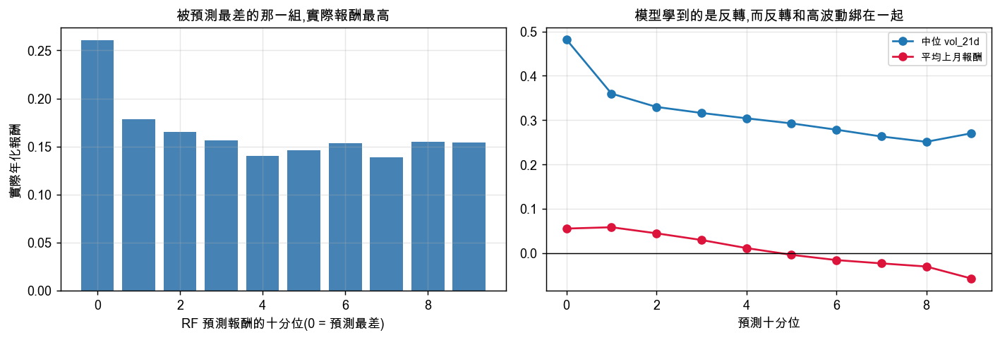

The model learned **short-term reversal** — it predicts the worst for last month's winners. Those
winners are also the highest-volatility, lowest-priced names, and the arithmetic mean of simple
returns is inflated by volatility itself. So the decile predicted to be worst earned the most.

**Rank IC and money are not the same thing.** Rank-normalizing the target throws away magnitude,
and IC cannot see any of the above. Read only the Part 3 table and Task A looks "weak but present";
trade it and the weak-but-present part is negative. A t-stat of +2.0 — exactly the threshold a paper
would call significant — is the most dangerous number in this project.

---

## Part 5 — Task B succeeded, so what

The model emits a rank in (0,1]; to use it you need a volatility **level**. The notebook maps the
rank back through the current month's cross-sectional quantile function of realized vol (month-end
information only, no look-ahead).

| Level estimate | Pearson corr | R² | MAE | Regression slope |
|---|---:|---:|---:|---:|
| **RF `vol_hat`** | **0.660** | **0.436** | **0.121** | 0.661 |
| Baseline `cur_vol_m` | 0.574 | 0.330 | 0.140 | 0.575 |

The RF wins on levels too. The slope of 0.66 < 1 is an honest defect of the rank→level map: it
over-extrapolates the extremes (rank 0.998 maps to the most extreme value in the current
cross-section, and next month regresses toward the middle). Fixing that properly means training on
`log(fwd_vol)` directly — which would no longer be "the same pipeline with only `y` swapped", so
this notebook does not do it.

### Calibration

| Predicted quintile | Q1 | Q2 | Q3 | Q4 | Q5 |
|---|---:|---:|---:|---:|---:|
| Median realized next-month vol | 0.191 | 0.244 | 0.293 | 0.367 | **0.558** |

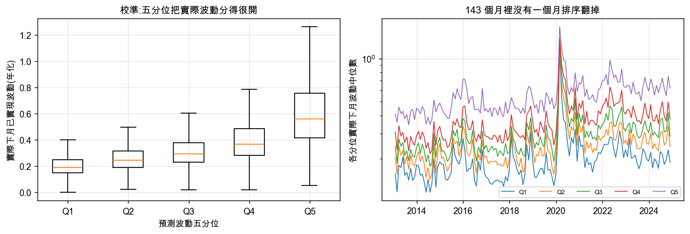

The quintile medians are **strictly monotone in 100% of the 143 OOS months**. Not a single month
where the ordering breaks.

### Position sizing: equal risk vs. equal dollar

Standardize each realized next-month return by its ex-ante risk estimate, `z = r / (σ̂/√12)`. If the
risk estimate is good, sd(z) should be *flat across volatility quintiles* — that is what equal risk
means.

| Risk estimate | Q1 | Q2 | Q3 | Q4 | Q5 | Q5/Q1 |
|---|---:|---:|---:|---:|---:|---:|
| Equal dollar (no division) | 0.24 | 0.29 | 0.35 | 0.45 | 0.73 | 2.98 |
| ÷ `cur_vol_m` | 1.69 | 1.23 | 1.21 | 1.23 | 1.23 | 0.73 |
| ÷ RF `vol_hat` | 1.55 | 1.19 | 1.13 | 1.11 | **1.05** | **0.68** |

Portfolio level, top 500 by dollar volume, long only:

| Weighting | Ann. return | Ann. vol | Sharpe | sd of rolling 12M vol |
|---|---:|---:|---:|---:|
| Equal dollar | +0.140 | 0.173 | 0.81 | 0.0680 |
| 1 / `cur_vol_m` | +0.134 | 0.153 | 0.88 | 0.0609 |
| 1 / RF `vol_hat` | +0.131 | 0.150 | 0.87 | **0.0594** |

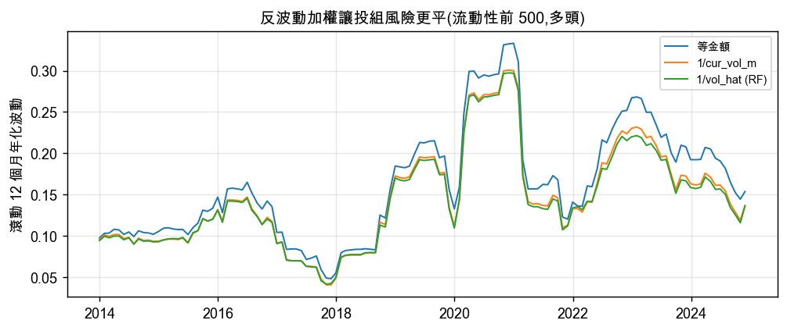

Equal-risk sizing genuinely flattens the risk profile. But **the RF's gain over "just use this
month's volatility" is marginal** (0.0594 vs. 0.0609), which is the same lesson again: the
predictability lives in the target, and a better model collects only the margin.

### Options premium quality (illustrative only)

Covered-call writing needs to know whether next month's realized volatility will support the implied
volatility being paid. The notebook takes the last OOS month (2024-11-29), restricts to the top 500
by dollar volume, and lists the extremes of the predicted-volatility ranking next to **what actually
happened in December 2024**:

| Highest predicted | Realized Dec-2024 vol | | Lowest predicted | Realized Dec-2024 vol |
|---|---:|---|---|---:|
| DJT | 0.569 | | LIN | 0.145 |
| SMCI | 1.142 | | MMC | 0.148 |
| LUNR | 1.158 | | JNJ | 0.148 |
| WULF | 1.330 | | KO | 0.145 |
| SMR | 0.879 | | ADP | 0.156 |
| ASTS | 0.686 | | PG | 0.136 |

Top 50 vs. bottom 50, median realized December volatility: **0.674 vs. 0.148 — a 4.6× spread.**

No account data is involved; this is a pure cross-sectional illustration so the notebook can stay
public. And it is only half of the problem: the other half is implied volatility, which this dataset
does not contain.

---

## Part 6 — diagnostics

Permutation importance (not impurity importance, which is biased toward high-cardinality features),
computed on the 2024 fold.

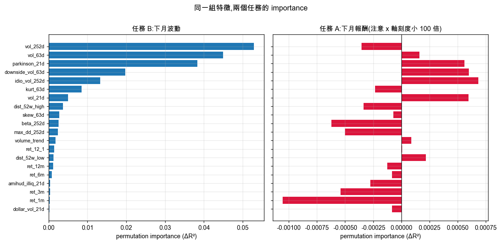

| | Task A: return | Task B: volatility |
|---|---:|---:|
| Sum of positive importances | 0.0029 | 0.2012 |
| Features with negative importance | 12 of 20 | 0 of 20 |
| Largest single importance | `idio_vol_252d` +0.00068 | `vol_252d` +0.0529 |
| Top-5 share | n/a (the total is noise) | 84%, all volatility-family |
| OOB R² / test R² | 0.0043 / 0.0005 | 0.6183 / 0.6531 |

Task B's importance is concentrated in `vol_252d`, `vol_63d`, `parkinson_21d`, `downside_vol_63d`
and `idio_vol_252d` — the model learned exactly what it should have, and the IC it adds over the
persistence baseline comes from blending volatility windows. Task A's importances all fall within
±0.0011 and **12 of 20 are negative** (permuting the feature *improves* R²). That is not "importance
spread thinly across noise"; it is no signal to allocate.

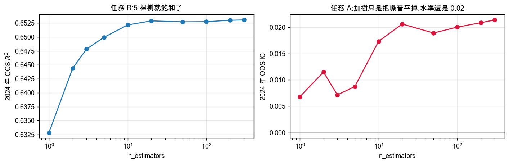

| n_estimators | 1 | 5 | 20 | 100 | 300 |
|---|---:|---:|---:|---:|---:|
| Task B, OOS R² | 0.6329 | 0.6500 | 0.6529 | 0.6527 | 0.6531 |
| Task A, OOS IC | 0.0068 | 0.0087 | 0.0206 | 0.0200 | 0.0214 |

Task B saturates at **five trees** — the signal is strong and smooth, so bagging has almost nothing
to do, the exact opposite of the synthetic panel in Part 1 (0.644 → 0.807). Task A's IC climbs from
0.007 to 0.021 purely by averaging a single tree's noise away, and then stops at 0.02.

---

## Conclusion

1. **Same model, two targets, two orders of magnitude apart.** R² −0.0002 vs. +0.6143; IC +0.016 vs.
   +0.777. Identical features, hyperparameters, folds, embargo and data. Only `y` differs.
2. **The ceiling is the target, not the model.** Part 1 rules out a broken pipeline (R² 0.81 against
   a 0.88 ceiling on synthetic data, importance ordering recovered with Spearman 1.0), and the noise
   sweep shows the same model running from R² 0.90 to 0.004 on SNR alone. Swapping in XGBoost,
   LightGBM or a neural net changes the function class and the bias — Task A is not short of either.
   It is short of signal.
3. **"Weak but present" is more dangerous than "absent".** Task A's IC t-stat is +2.0. Traded as a
   decile long-short it loses money with t = −2.8, because the model found reversal and reversal is
   entangled with high volatility and low prices. Rank IC is not money.
4. **Survivorship bias** makes Task A's numbers optimistic and barely touches Task B's, so the
   comparison survives it.
5. **What this data can and cannot do:**

| Can | Cannot |
|---|---|
| Cross-sectional volatility prediction (IC 0.78, 143/143 months positive) | Cross-sectional return prediction (IC 0.016, negative after costs) |
| Equal-risk sizing, risk bucketing, the realized-vol half of an options decision | Implied volatility, IV/RV ratios — no option quotes in this dataset |
| Robustness across regimes (2008, 2020, 2022 all included) | Real delisting and bankruptcy risk (survivorship bias) |
| Any price/volume feature computable from daily OHLCV | Any fundamental factor — no financial statements |

### If this were taken further

1. Train on `log(fwd_vol)` directly instead of mapping ranks back to levels (the 0.66 regression
   slope in Part 5 is that defect).
2. Join the volatility forecast to real option quotes to get IV/RV, which is the missing half of
   "is this premium expensive?".
3. For returns, the productive move is **different data** — point-in-time fundamentals, estimate
   revisions, holdings, news — not a different estimator. Go looking for signal, not for a better
   function approximator.

---

## Running it

```bash
git clone https://github.com/lukerspace/ML-RF-Volatility-vs-Returns.git
cd ML-RF-Volatility-vs-Returns
pip install -r requirements.txt
jupyter lab rf_russell3000.ipynb
```

Restart & Run All takes roughly 25–45 minutes on an 8-core machine depending on what else is
running, almost all of it in the 24 walk-forward fits. Every figure in this README is written to `assets/` by the notebook itself, so
the numbers here and the notebook's outputs cannot drift apart.

The price parquet is **not** in this repo (305MB) and is read through the centralized loader. To run
the notebook elsewhere, point `load_us_price_data` at your own Russell 3000 OHLCV panel with a
MultiIndex `(Price, Ticker)` column layout.

## Project layout

```
ML-RF-Volatility-vs-Returns/
├── rf_russell3000.ipynb     # the whole project: synthetic validation → features → walk-forward → strategy → diagnostics
├── assets/                  # all 13 figures, written by the notebook
├── requirements.txt
├── README.md
└── LICENSE
```

| Notebook part | Content |
|---|---|
| 0 | Environment, loader, coverage by year, survivorship-bias warning |
| 1 | Mechanism check on synthetic data: bagging variance decay, importance recovery, noise sweep |
| 2 | 20 features from OHLCV, both targets, normalization, univariate ICs |
| 3 | 12-fold walk-forward, both tasks, baselines (**the core**) |
| 4 | Task A as a real strategy: deciles, costs, momentum benchmark |
| 5 | Task B in use: calibration, equal-risk sizing, options premium illustration |
| 6 | Permutation importance, learning curve, OOB |

## License

MIT
